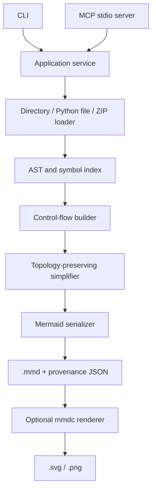

# Architecture

Modules:

- `project.py`: file enumeration, archive safety, `ast.parse`, top-level symbols, best-effort imports and call resolution.
- `analysis.py`: ordered statements, conditional/loop paths, selective orchestrator inlining, `FlowGraph` operations.
- `models.py`: portable intermediate representation (`Node`, `Edge`, `FlowGraph`), each activity carries source symbol(s) and file location(s).
- `mermaid.py`: pure serializer; no source-specific heuristics.
- `render.py`: optional subprocess invocation of an installed Mermaid CLI without shell interpolation.
- `service.py`: single API used by all entry points.
- `cli.py`, `mcp_server.py`: thin interfaces. MCP checks allowed workspace roots.

## Non-goals for V1

Full language-level dataflow, precise type inference, exact exception semantics, branch feasibility, fully qualified import graphs, and executing untrusted source. These should not be silently claimed as supported.

## Design constraints

- Deterministic: no LLM required.
- Conservative: when simplification cannot retain decision topology, keep nodes above budget and warn.
- Traceable: stable intermediate graph plus original file/line references.
- Safe by default: inspect source as text, refuse ZIP traversal, keep MCP filesystem operations inside configured workspace roots.
