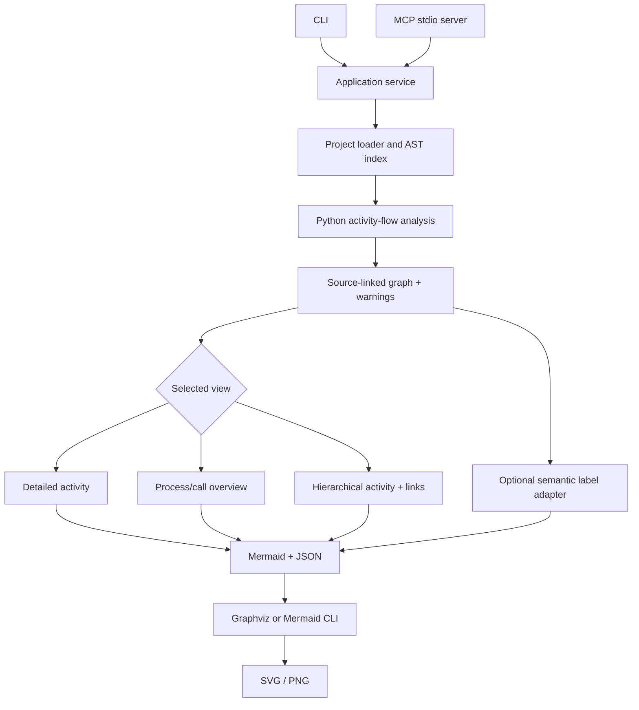

# Architecture

PyFlowMap separates **source inspection**, **static-flow construction**,
**presentation**, and **optional label enrichment**. Parsing analyzed projects
does not import or execute them.

## Main responsibilities

| Module | Responsibility |
| --- | --- |
| `project.py` | Source files, ZIP safety, Python AST, symbols and best-effort call lookup |
| `analysis.py`, `diagrams/activity.py` | Branch/exception/loop flow and bounded interprocedural expansion |
| `models.py` | Graph nodes, edges, source locations and metadata |
| `overview.py`, `hierarchy.py` | Summaries and navigable hierarchical views |
| `mermaid.py`, `dot.py`, `render.py` | Mermaid serialization and optional Graphviz/Mermaid image rendering |
| `semantic/`, `integrations/` | Optional activity-label enrichment; never changes graph topology |
| `service.py` | Shared application API for inspection/generation |
| `cli.py`, `mcp_server.py` | CLI and stdio MCP; MCP enforces allowed workspace roots |

The base analysis is deterministic and usable without a language model.
The optional labeler is activated explicitly. Provider results can change
only permitted activity text and label metadata; flow edges, decision semantics
and provenance are not delegated to inference.

## Generated artifacts

A normal analysis emits source-linked `.json` and editable `.mmd`.
Graphviz or Mermaid CLI may additionally generate `.svg` and `.png`.
Hierarchical runs can generate indexes and subdiagram links. `overview`
describes possible call relationships: an overview edge is not necessarily
an unconditional execution order.

## Boundaries

- **Source:** no source execution, best-effort imports/calls, conservative
  uncertainty for dynamic Python features.
- **Filesystem:** safe extraction and bounded temporary paths; MCP source and
  output paths must be within `PYFLOWMAP_ALLOWED_ROOTS`.
- **Presentation:** no destructive simplification to satisfy an exact
  node budget.
- **Release:** the installed package contains the runtime, not `tests/`,
  `benchmark/`, temporary outputs, development reports, or credentials.
- **Evaluation:** test suites, semantic oracles, and independent banks are
  developer tooling, not runtime dependencies.

See [analysis rules](analysis-rules.md), [diagram types](diagram-types.md) and
[semantic labeling](semantic-labeling.md).
