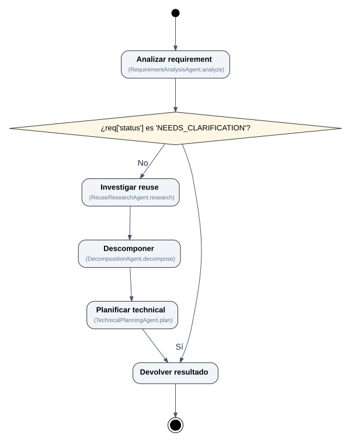

# P4 Planning Agent — generic activity labels

Pinned read-only source: `SergioGilBorras/P4-Planning-Agent`, commit `8e68c720bef75e24acd6b3ed8a237b41fa3a838d`. **No P4-specific label mappings.**



[PNG](planning_coordinator_PlanningCoordinator_plan.png) · [SVG](planning_coordinator_PlanningCoordinator_plan.svg) · [Mermaid (.mmd)](planning_coordinator_PlanningCoordinator_plan.mmd) · [Mermaid text (.txt)](planning_coordinator_PlanningCoordinator_plan.txt) · [JSON](planning_coordinator_PlanningCoordinator_plan.json)

Reproduce using the pinned reference fixture:

```bash
pyflowmap analyze tests/fixtures/references/p4-planning-agent-v1 \
  --entry planning.coordinator:PlanningCoordinator.plan \
  --language es --format images --renderer graphviz \
  --output examples/results/p4-planning-agent-generic
```

These are deterministic labels based on function names, class identifiers and docstrings. Unknown technical nouns may remain untranslated (`Analizar requirement`); optional semantic labeling is a separate opt-in provider and is **not** enabled for this example. Decisions preserve actual predicate truth values (Sí=true, No=false).

The earlier baseline and V1.1 examples remain available for before/after comparison.
