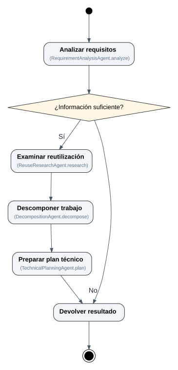

# P4 Planning Agent — presentation iteration V1.2

Pinned, read-only P4 commit: `8e68c720bef75e24acd6b3ed8a237b41fa3a838d`. This is historical output, not the current generic labeler.

[PNG](coordinator_activity_v1_2.png) · [SVG](coordinator_activity_v1_2.svg) · [Mermaid (.mmd)](coordinator_activity_v1_2.mmd) · [Mermaid text (.txt)](coordinator_activity_v1_2.txt) · [JSON](coordinator_activity_v1_2.json)

The presentation adds larger primary titles, smaller source-symbol captions and more readable branch labels. The preview uses Graphviz; Mermaid CLI visual rendering is not independently verified here.
