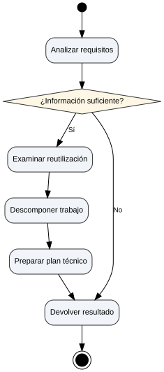

# P4 Planning Agent — UML activity V1.1 historical preview

Pinned, read-only P4 commit: `8e68c720bef75e24acd6b3ed8a237b41fa3a838d`. This historical preview was generated from a representative coordinator. See the pinned source fixture for the complete project.

[PNG](coordinator_activity.png) · [SVG](coordinator_activity.svg) · [Mermaid (.mmd)](coordinator_activity.mmd) · [Mermaid text (.txt)](coordinator_activity.txt) · [JSON](coordinator_activity.json)

Includes a start node, shared result and activity final; historical labels are retained for regression comparison. The diagram is a static approximation, not a runtime trace.

[Presentation iteration V1.2](README-V1.2.md) · [Current generic labeling example](../p4-planning-agent-generic/README.md)
