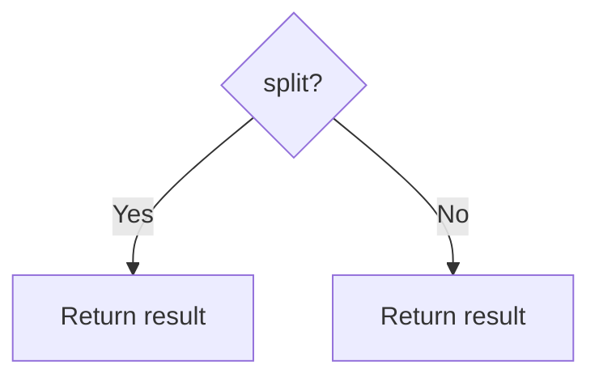
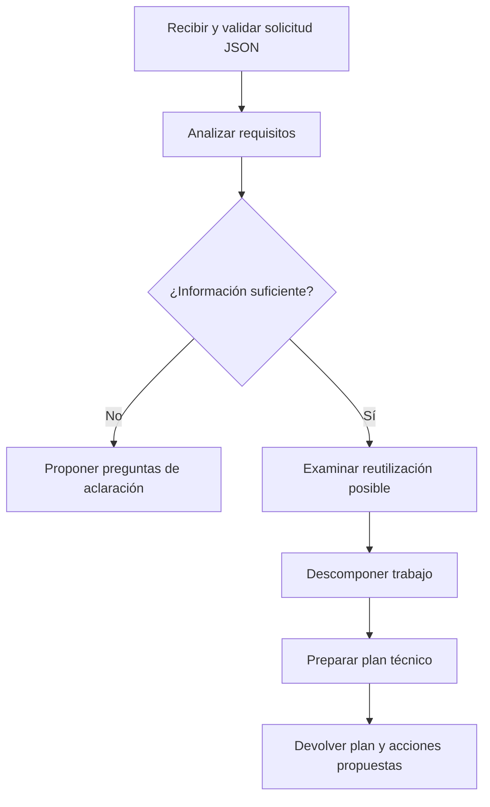

# PyFlowMap: prueba de P4-Planning-Agent

**Origen:** [P4-Planning-Agent](https://github.com/SergioGilBorras/P4-Planning-Agent), rama main, commit `8e68c720bef75e24acd6b3ed8a237b41fa3a838d`.

**Motor:** PyFlowMap, commit `05c051941e78da859543e6c23b7bbef2504cd237`.

**Seguridad / procedencia:** análisis de una copia local **solo lectura**, con los 10 archivos Python de la aplicación (entrada, planning y adapters), sin los tests. Se verificó que el hash Git de los 10 archivos coincidía con los blobs de GitHub. No se importó, ejecutó ni modificó el proyecto P4.

## Coordinador principal — resultado AUTOMÁTICO (7 nodos)

```mermaid
flowchart TD
    n1["Analyze"]
    n2{"req[&#x27;status&#x27;] == &#x27;NEEDS_CLARIFICATION&#x27;?"}
    n3["Planning result"]
    n4["Research"]
    n5["Decompose"]
    n6["Plan"]
    n7["Planning result"]
    n1 --> n2
    n2 -->|Yes| n3
    n2 -->|No| n4
    n4 --> n5
    n5 --> n6
    n6 --> n7
```

**Evaluación:** estructura general útil; etiquetas todavía demasiado genéricas: "Analyze", "Research", "Plan", "Planning result". No resuelve el tipo de `self.requirement_agent` desde el constructor ni muestra explícitamente la composición de `jira_actions`.

## Entrada principal — resultado AUTOMÁTICO (20 nodos, objetivo 9)

```mermaid
flowchart TD
    n1{"Try succeeds?"}
    n2{"not isinstance(data, dict)?"}
    n3["Raise exception"]
    n4{"missing?"}
    n5["Raise exception"]
    n6{"More items in keys?"}
    n7{"not isinstance(data[k], str) or not data[k].strip()?"}
    n8["Raise exception"]
    n9{"data.get(&#x27;project_context&#x27;) is not None and (not isin…?"}
    n10["Raise exception"]
    n11{"data.get(&#x27;workspace&#x27;) is not None and (not isinstance…?"}
    n12["Raise exception"]
    n13["Cls"]
    n14["Analyze"]
    n15{"req[&#x27;status&#x27;] == &#x27;NEEDS_CLARIFICATION&#x27;?"}
    n16["Planning result"]
    n17["Research → … → Planning result"]
    n21["Write → Return result"]
    n23["Return result"]
    n24["Return result"]
    n1 -->|Yes| n2
    n2 -->|Yes| n3
    n2 -->|No| n4
    n4 -->|Yes| n5
    n4 -->|No| n6
    n6 -->|Yes| n7
    n7 -->|Yes| n8
    n7 -->|Next| n6
    n6 -->|No| n9
    n9 -->|Yes| n10
    n9 -->|No| n11
    n11 -->|Yes| n12
    n11 -->|No| n13
    n14 --> n15
    n15 -->|Yes| n16
    n15 -->|No| n17
    n1 -->|No| n23
    n1 -->|No| n24
```

**FALLO de fidelidad:** aparecen nodos desconectados; al expandir una función con retornos el analizador no reconecta correctamente la continuación. La excepción también se modela de forma aproximada. El diagrama excede el límite de nodos porque la simplificación preserva las decisiones existentes.

## Requisitos — resultado AUTOMÁTICO (1 nodo)

**Insuficiente:** la validación calculada en expresiones y asignaciones no aparece en el grafo.

## Descomposición — resultado AUTOMÁTICO (3 nodos)

**Parcial:** identifica `if split`, pero ambas salidas llevan la etiqueta "Return result".

## Esquema de referencia CURADO MANUALMENTE (no es resultado automático)

Este es el nivel de abstracción que buscamos en una iteración futura:

## Priorización de mejoras

1. Inferir campos `self.x` a partir de `__init__` y resolver `self.x.method()`.
2. Corregir las aristas después de `return` cuando se expanden funciones anidadas.
3. Detectar asignaciones y composición de resultados como actividades importantes.
4. Simplificar jerárquicamente sin inventar caminos; reconocer cuando el límite `max_nodes` no se puede cumplir.
5. Mejores etiquetas de actividades y semántica de ramas.

Los archivos `.mmd` de este directorio son las salidas sin modificar de PyFlowMap, salvo `reference_curated.mmd`, indicado como manual. El paquete de resultados adjunto en la conversación contiene adicionalmente los grafos originales `.json` y vistas `.svg` / `.png` renderizadas desde el JSON mediante Graphviz (el entorno no disponía de `mmdc`).
