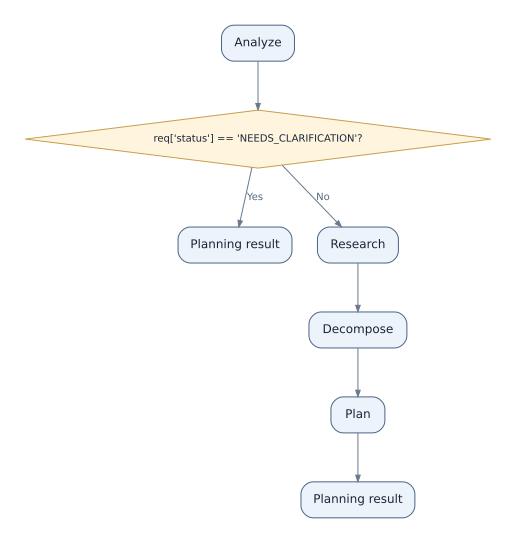
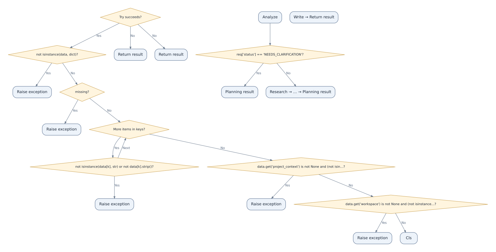
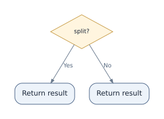
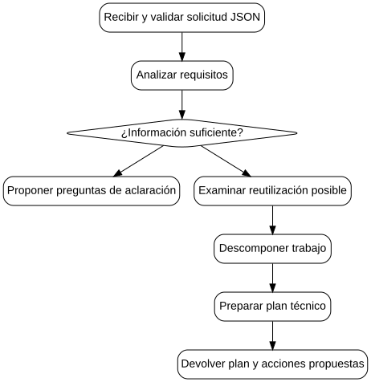

# P4 Planning Agent — historical baseline (initial analyzer)

> **Historical, known limitations.** Pinned read-only source: `SergioGilBorras/P4-Planning-Agent`, commit `8e68c720bef75e24acd6b3ed8a237b41fa3a838d`. Do not interpret these diagrams as verified runtime traces.

## Main coordinator (automatic, historical)

[PNG](coordinator_flow.png) · [SVG](coordinator_flow.svg) · [Mermaid (.mmd)](coordinator_flow.mmd) · [Mermaid text (.txt)](coordinator_flow.txt) · [JSON](coordinator_flow.json)

**Evaluation:** labels are vague and return nodes are duplicated; this is retained as a before/after reference.

## Entry point (automatic, historical)

[PNG](entrypoint_flow.png) · [SVG](entrypoint_flow.svg) · [Mermaid text (.txt)](entrypoint_flow.txt) · [Mermaid (.mmd)](entrypoint_flow.mmd) · [JSON](entrypoint_flow.json)

**Known issue:** disconnected parts and approximation of exception handling. Twenty nodes rather than the desired nine.

## Requirements (automatic, historical)

[PNG](requirements_flow.png) · [SVG](requirements_flow.svg) · [Mermaid text (.txt)](requirements_flow.txt) · [Mermaid (.mmd)](requirements_flow.mmd) · [JSON](requirements_flow.json)

**Known issue:** important validation details are missing.

## Decomposition (automatic, historical)

[PNG](decomposition_flow.png) · [SVG](decomposition_flow.svg) · [Mermaid text (.txt)](decomposition_flow.txt) · [Mermaid (.mmd)](decomposition_flow.mmd) · [JSON](decomposition_flow.json)

**Known issue:** two branches are represented as generic returns.

## Manually curated reference (NOT an automatic result)

[PNG](reference_curated.png) · [SVG](reference_curated.svg) · [Mermaid text (.txt)](reference_curated.txt) · [Mermaid (.mmd)](reference_curated.mmd)

No source files from the P4 project were modified. These artifacts are retained to compare improvements to the activity analyzer.
